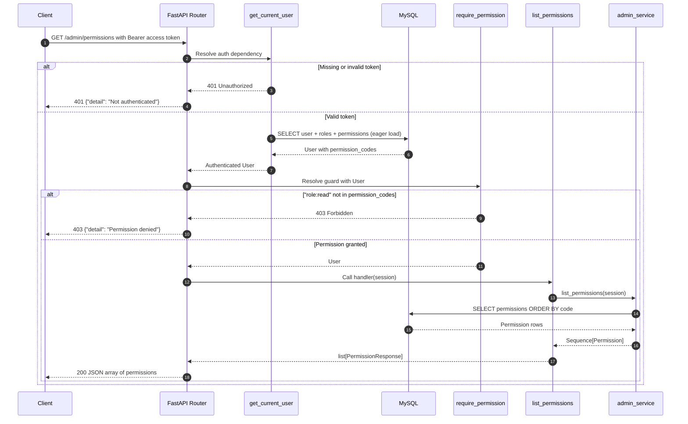
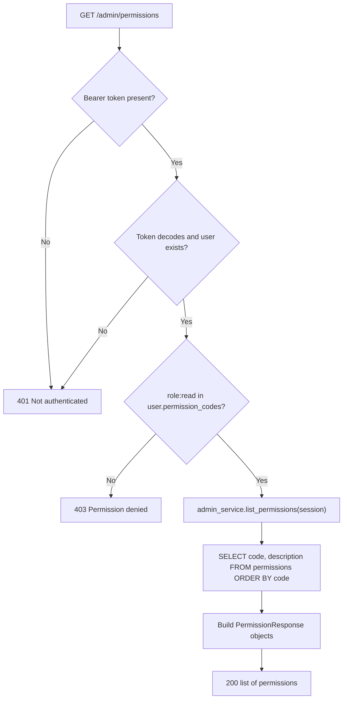
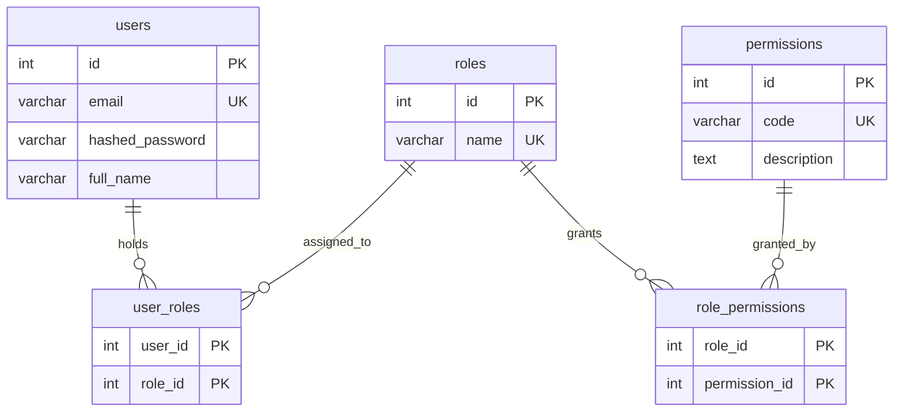

# `GET /admin/permissions` — Request Flow

Paste any block below into <https://mermaid.live> (or a Markdown preview with Mermaid support).

## 1. Sequence diagram

## 2. Authorization decision

## 3. Where `role:read` comes from

`get_current_user` loads `users → user_roles → roles → role_permissions → permissions`
and flattens the result into `user.permission_codes`. The guard then checks one code
against that set — it never trusts roles or permissions from the JWT.
