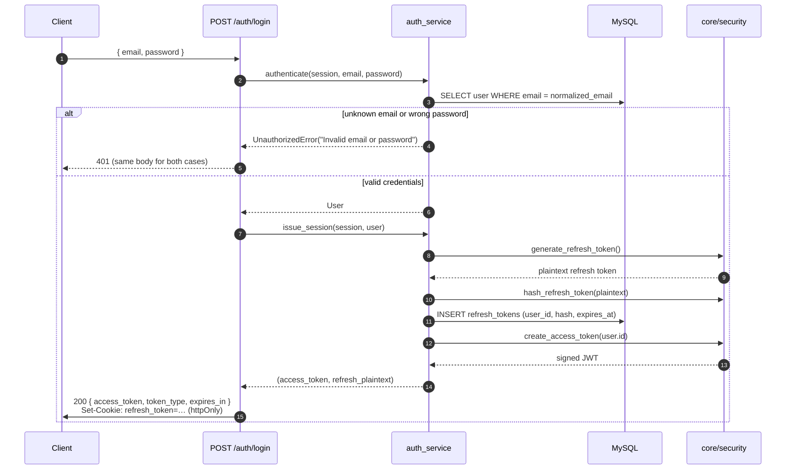
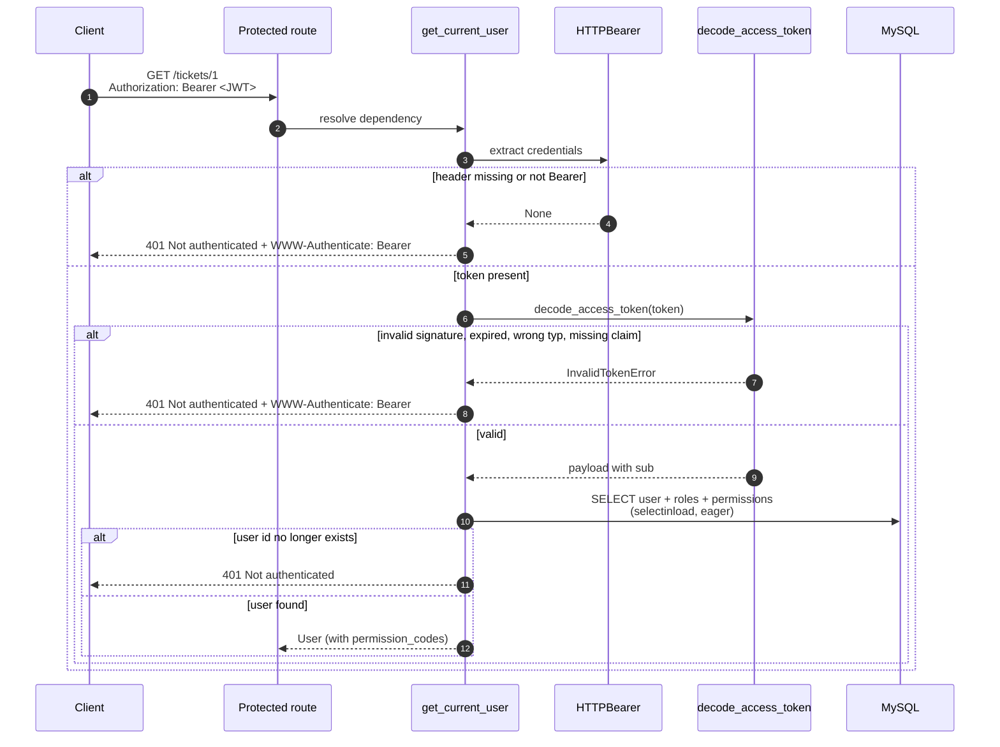
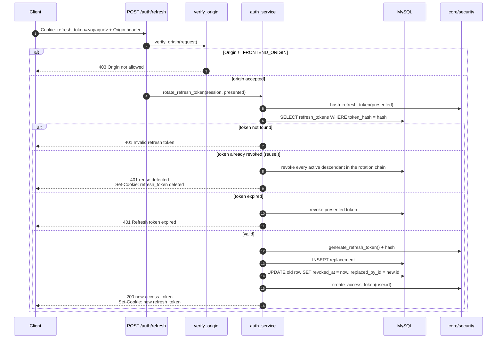

# JWT Authentication Flow

How the backend authenticates requests, where every JWT-related function lives, and how the
access token relates to the refresh token and the RBAC permission check.

> **Short version:** the JWT proves **who you are**. It never contains roles or permissions.
> Permissions are loaded from MySQL on every request.

---

## 1. The two-token design

| Token | Format | Lifetime | Client storage | Server storage | Purpose |
|---|---|---|---|---|---|
| **Access token** | JWT (`HS256`) | 15 minutes | Memory (frontend), sent as `Authorization: Bearer …` | **Not stored** | Proves identity on API requests |
| **Refresh token** | Opaque random string (not a JWT) | 7 days | `httpOnly` cookie `refresh_token` | SHA-256 hash in `refresh_tokens.token_hash` | Obtains a new access token |

Why split them:

- The access token is short-lived, so a leaked one expires quickly.
- The refresh token is long-lived but `httpOnly` (JavaScript cannot read it) and stored only as a hash.
- Neither token carries authorization data, so role changes take effect on the next request without
  reissuing anything.

---

## 2. Where everything lives

| File | Responsibility |
|---|---|
| `app/core/security.py` | JWT encode/decode, password hashing, refresh-token generation/hashing |
| `app/services/auth_service.py` | Register, authenticate, issue session, rotate refresh token, logout |
| `app/api/routes/auth.py` | `/auth/register`, `/auth/login`, `/auth/refresh`, `/auth/logout`, `/auth/me` |
| `app/api/deps.py` | `get_current_user` (decodes JWT + loads grants), `require_permission`, `require_any_permission` |
| `app/models/refresh_token.py` | Refresh-token persistence, rotation chain, revocation fields |
| `app/core/config.py` | `SECRET_KEY`, `ACCESS_TOKEN_MINUTES`, `REFRESH_TOKEN_DAYS`, `FRONTEND_ORIGIN` |
| `app/main.py` | Maps `AppError` to HTTP responses; clears the refresh cookie on reuse detection |

---

## 3. Configuration

From `app/core/config.py` and `.env.example`:

| Setting | Default | Used by |
|---|---|---|
| `SECRET_KEY` | required, min 32 chars | JWT signature (HMAC-SHA256) |
| `ACCESS_TOKEN_MINUTES` | `15` | `create_access_token` expiry, `expires_in` response |
| `REFRESH_TOKEN_DAYS` | `7` | Refresh-token expiry and cookie `max_age` |
| `FRONTEND_ORIGIN` | `http://localhost:5173` | `verify_origin` on `/auth/refresh` and `/auth/logout` |

Constants in `app/core/security.py`:

```python
JWT_ALGORITHM = "HS256"
ACCESS_TOKEN_TYPE = "access"
REFRESH_COOKIE_NAME = "refresh_token"
```

---

## 4. JWT primitives — `app/core/security.py`

### `create_access_token(user_id: int) -> str`

Builds and signs the access JWT.

```python
now = datetime.now(UTC)
payload = {
    "sub": str(user_id),          # identity only
    "iat": now,                   # issued at
    "exp": now + timedelta(minutes=settings.access_token_minutes),
    "typ": "access",              # prevents using a refresh/other token type
}
return jwt.encode(payload, settings.secret_key, algorithm=JWT_ALGORITHM)
```

Example decoded payload:

```json
{
  "sub": "1",
  "iat": 1763300000,
  "exp": 1763300900,
  "typ": "access"
}
```

A JWT is three base64url parts: `header.payload.signature`. The signature is HMAC-SHA256 over
`header.payload` using `SECRET_KEY`, so any tampering invalidates the token.

### `decode_access_token(token: str) -> dict[str, object]`

Validates the token and returns its claims.

```python
payload = jwt.decode(
    token,
    settings.secret_key,
    algorithms=[JWT_ALGORITHM],
    options={"require": ["sub", "iat", "exp", "typ"]},
)
if payload.get("typ") != ACCESS_TOKEN_TYPE:
    raise InvalidTokenError("Not an access token")
return payload
```

It enforces:

- **Signature** — token was signed with `SECRET_KEY` and not modified.
- **`alg` whitelist** — only `HS256`; blocks algorithm-confusion attacks.
- **Expiry** — PyJWT verifies `exp` automatically.
- **Required claims** — `sub`, `iat`, `exp`, `typ` must all exist.
- **Token type** — `typ` must be `"access"`.

Any failure raises `jwt.InvalidTokenError`, which `get_current_user` turns into `401`.

### Refresh-token helpers (not JWT)

```python
def generate_refresh_token() -> str:
    return secrets.token_urlsafe(32)          # 256 bits of entropy

def hash_refresh_token(token: str) -> str:
    return hashlib.sha256(token.encode("utf-8")).hexdigest()
```

Only the SHA-256 hash is stored. The plaintext exists only inside the `httpOnly` cookie.

### Password helpers

```python
async def hash_password(password: str) -> str        # bcrypt, cost 12, in a threadpool
async def verify_password(password, hashed) -> bool  # bcrypt verify, in a threadpool
def utcnow() -> datetime                             # naive UTC, matches MySQL DATETIME
```

---

## 5. Login flow

Route: `POST /auth/login` → `auth_service.authenticate` → `auth_service.issue_session`.



Sample request:

```http
POST /auth/login HTTP/1.1
Content-Type: application/json

{ "email": "alice@example.com", "password": "DevPassw0rd!" }
```

Sample response:

```http
HTTP/1.1 200 OK
Set-Cookie: refresh_token=<opaque>; HttpOnly; Max-Age=604800; Path=/auth; SameSite=lax

{
  "access_token": "eyJhbGciOiJIUzI1NiIs...",
  "token_type": "bearer",
  "expires_in": 900
}
```

Cookie settings (`_set_refresh_cookie` in `routes/auth.py`):

- `httponly=True` — JavaScript cannot read it (XSS mitigation).
- `samesite="lax"` — not sent on cross-site subrequests.
- `path="/auth"` — only `/auth/refresh` and `/auth/logout` receive it.
- `secure=settings.is_production` — HTTPS-only in production, relaxed for local HTTP.

Registration (`POST /auth/register`) creates a **customer** and returns the user, but does **not**
log in automatically. The client must call `/auth/login` afterward.

---

## 6. Authenticated request flow

Every protected route depends on `get_current_user` (directly through `CurrentUser`, or indirectly
through a permission guard).



Key points:

- The route never sees the RAW token — only the loaded `User`.
- The token's `sub` is the **only** thing taken from the JWT.
- Roles and permissions come from MySQL on **every request**. This is why a role change takes effect
  immediately, with the same access token.

`get_current_user` uses `HTTPBearer(auto_error=False)` so it can raise its own `401` with the
`WWW-Authenticate: Bearer` header for both missing and invalid credentials.

---

## 7. Authorization uses MySQL, not the JWT

After `get_current_user`, a guard checks the database-resolved permission set:

```python
# require_permission: exact code required
if code not in user.permission_codes:
    raise HTTPException(403)

# require_any_permission: at least one code required
if user.permission_codes.isdisjoint(allowed):
    raise HTTPException(403)
```

`user.permission_codes` is built in `app/models/user.py` by flattening:

```text
users → user_roles → roles → role_permissions → permissions
```

So the JWT is used exactly once per request — to resolve identity. Authorization never reads the
token again. See `docs/admin-permissions-flow.md` for the full `GET /admin/permissions` diagram.

---

## 8. Refresh flow (rotation)

Route: `POST /auth/refresh` → `auth_service.rotate_refresh_token`.



Rotation rules:

- A successful refresh **always** replaces the refresh token. The old one is marked
  `revoked_at` and linked through `replaced_by_id`.
- Reusing an already-rotated token is treated as theft: `_revoke_descendants` walks the chain
  forward and revokes every still-active replacement. The legitimate client is logged out too.
- `RefreshReuseError` sets `clear_refresh_cookie = True`; the global handler in `app/main.py`
  deletes the cookie in the error response.
- Expired tokens are revoked and rejected with `401`.
- The refresh token is looked up by hash, so a database leak does not expose usable tokens.

`verify_origin` requires an exact `Origin` header match against `FRONTEND_ORIGIN` for both
`/auth/refresh` and `/auth/logout`, as CSRF defence for cookie-based endpoints.

The refresh endpoint returns only a new access token (`TokenResponse`); the new refresh token
travels exclusively in the `httpOnly` cookie.

---

## 9. Logout

Route: `POST /auth/logout` → `verify_origin` → `revoke_refresh_token` → `204`.

- If the cookie exists, the matching row gets `revoked_at = now`.
- If it does not exist, logout is still `204` (idempotent).
- The cookie is deleted with `Path=/auth`.
- The access token is **not** revocable — it simply expires within 15 minutes. It is never stored
  server-side.

---

## 10. `GET /auth/me`

`me` depends on `CurrentUser` (`Annotated[User, Depends(get_current_user)]`), so it exercises the
full JWT → MySQL path:

```json
{
  "id": 1,
  "email": "alice@example.com",
  "full_name": "Alice Customer",
  "roles": ["customer"],
  "permissions": ["ticket:create", "ticket:read_own"]
}
```

`roles` and `permissions` are sorted from `user.role_names` and `user.permission_codes` — useful
for debugging that the guard will see exactly those codes on the next request.

---

## 11. Function reference

### `app/core/security.py`

| Function | Signature | Purpose |
|---|---|---|
| `utcnow` | `() -> datetime` | Naive UTC now, matching MySQL `DATETIME` |
| `hash_password` | `async (password: str) -> str` | bcrypt hash in a threadpool |
| `verify_password` | `async (password: str, hashed: str) -> bool` | bcrypt verify in a threadpool |
| `create_access_token` | `(user_id: int) -> str` | Sign a 15-minute JWT with `sub`/`iat`/`exp`/`typ` |
| `decode_access_token` | `(token: str) -> dict[str, object]` | Verify signature/expiry/claims/type; raise `InvalidTokenError` |
| `generate_refresh_token` | `() -> str` | 256-bit URL-safe opaque token |
| `hash_refresh_token` | `(token: str) -> str` | SHA-256 hex, stored in the database |

### `app/services/auth_service.py`

| Function | Signature | Purpose |
|---|---|---|
| `normalize_email` | `(email: str) -> str` | Trim + lowercase before lookup/storage |
| `register` | `async (session, payload) -> User` | Create a customer; assign the `customer` role |
| `authenticate` | `async (session, email, password) -> User` | Generic `401` for unknown email or wrong password |
| `issue_session` | `async (session, user) -> tuple[str, str]` | Persist refresh hash; return `(access_jwt, refresh_plaintext)` |
| `_revoke_descendants` | `async (session, token, now) -> None` | Walk `replaced_by_id` forward, revoking active replacements |
| `rotate_refresh_token` | `async (session, presented) -> tuple[User, str, str]` | Validate, revoke, replace, and issue a new access token |
| `revoke_refresh_token` | `async (session, presented) -> None` | Idempotent logout revocation |

### `app/api/deps.py`

| Function | Signature | Purpose |
|---|---|---|
| `_unauthorized` | `() -> HTTPException` | `401` + `WWW-Authenticate: Bearer` |
| `get_current_user` | `async (session, credentials) -> User` | Decode JWT, load user + roles + permissions |
| `verify_origin` | `async (request) -> None` | Exact `Origin` check for refresh/logout |
| `require_permission` | `(code) -> Callable[..., Awaitable[User]]` | All-of-one permission guard (`403`) |
| `require_any_permission` | `(*codes) -> Callable[..., Awaitable[User]]` | Any-of permission guard (`403`) |

### `app/api/routes/auth.py`

| Function | Route | Purpose |
|---|---|---|
| `_set_refresh_cookie` | — | Write the `httpOnly` refresh cookie |
| `register` | `POST /auth/register` | Create a customer (`201`) |
| `login` | `POST /auth/login` | Issue JWT + refresh cookie (`200`) |
| `refresh` | `POST /auth/refresh` | Rotate refresh token, issue new JWT (`200`) |
| `logout` | `POST /auth/logout` | Revoke refresh token, clear cookie (`204`) |
| `me` | `GET /auth/me` | Return identity + DB-resolved roles/permissions |

### `app/models/refresh_token.py`

| Column | Meaning |
|---|---|
| `token_hash` | SHA-256 hex of the opaque token; unique |
| `expires_at` | Absolute expiry (`now + REFRESH_TOKEN_DAYS`) |
| `revoked_at` | Set on rotation, logout, or reuse detection |
| `replaced_by_id` | Self-FK forming the rotation chain; `ON DELETE SET NULL` |
| `created_at` | Server-side default timestamp |

---

## 12. Error behaviour

| Situation | Status | Body |
|---|---|---|
| No `Authorization` header | `401` + `WWW-Authenticate: Bearer` | `{"detail": "Not authenticated"}` |
| Invalid signature / expired / malformed JWT | `401` + `WWW-Authenticate: Bearer` | `{"detail": "Not authenticated"}` |
| Token `typ` is not `"access"` | `401` + `WWW-Authenticate: Bearer` | `{"detail": "Not authenticated"}` |
| Valid JWT but the user no longer exists | `401` + `WWW-Authenticate: Bearer` | `{"detail": "Not authenticated"}` |
| Authenticated but missing a permission | `403` | `{"detail": "Permission denied"}` / `{"detail": "Insufficient permissions"}` |
| Login with unknown email or wrong password | `401` | `{"detail": "Invalid email or password"}` (identical) |
| Refresh token missing/unknown/expired | `401` | `{"detail": "Invalid refresh token"}` / `{"detail": "Refresh token expired"}` |
| Refresh token reused | `401` + cookie cleared | `{"detail": "Refresh token reuse detected; please log in again"}` |
| Refresh/logout from a wrong `Origin` | `403` | `{"detail": "Origin not allowed"}` |

`401` means *"I do not know who you are."* `403` means *"I know who you are, but you may not do
this."* Guards never produce `401`, and `get_current_user` never produces `403`.

---

## 13. What is deliberately **not** in the JWT

| Not included | Why |
|---|---|
| Roles | A role rename or reassignment must not require a token reissue |
| Permissions | The database is the runtime authority; grants can change per request |
| `is_superuser` | No superuser bypass exists — admin holds explicit permission rows |
| Refresh token | It is opaque, not a JWT, and only its hash is stored |
| Profile data | Keeps the token small and avoids stale personal data |

Consequences to remember:

- Do not decode the JWT inside a guard to make an access decision — it has no grants.
- Do not trust a role/permission supplied in a request body — registration and ticket creation
  deliberately ignore such fields.
- Revoking access is a database change; the next request picks it up automatically.

---

## 14. Related documents

- `docs/M1-3-authorization-task.md` — guard contracts and the 401/403/404 decision table.
- `docs/admin-permissions-flow.md` — request-flow and ER diagrams for a guarded admin endpoint.
- `specs/constitution.md` — JWT/refresh/bcrypt rules.
