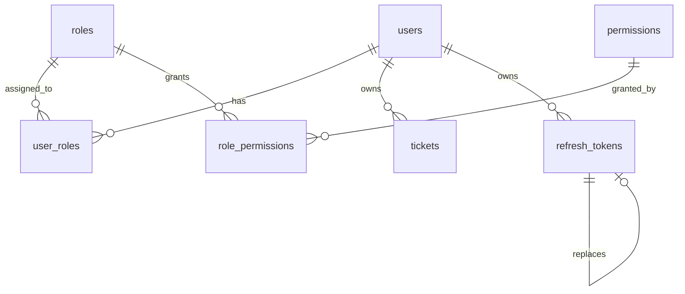
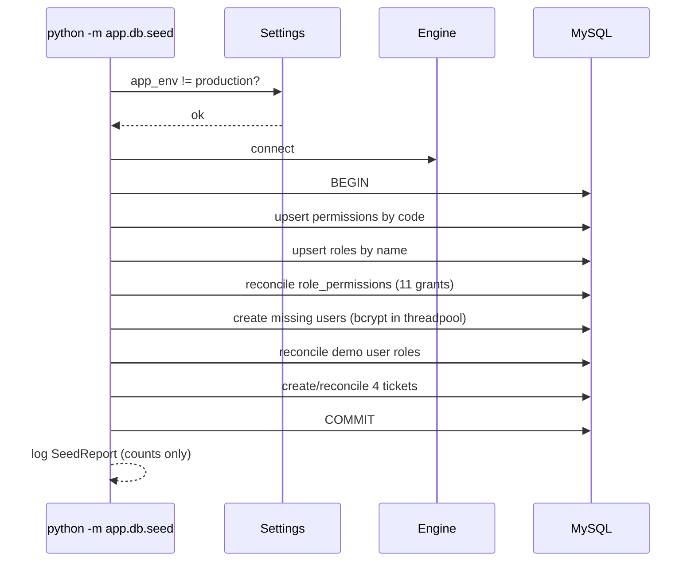
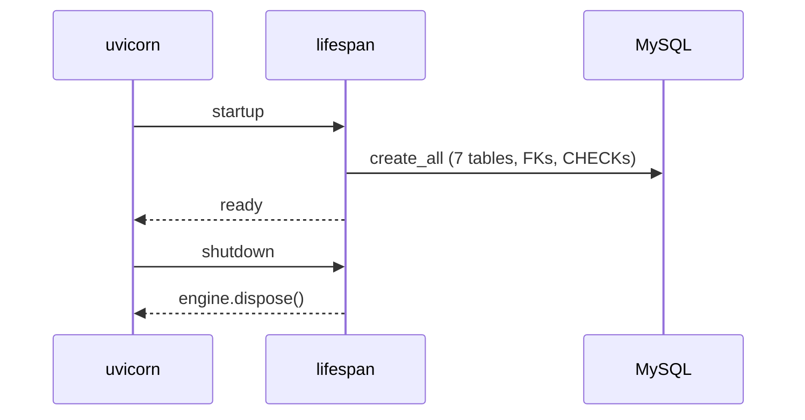

# M1-1 — Implementation Design

**Status:** Approved · **Milestone:** M1-1 · **Date:** 2026-11-13
**Triad:** [specification.md](specification.md) · [implementation.md](implementation.md) · [validation.md](validation.md)

---

## 1. Architectural Overview

M1-1 is **persistence-only**. There are no routers, services, or Pydantic schemas yet. The
boundaries touched are:

```
app/core/enums.py       → TicketStatus, RoleName, PermissionCode
app/core/catalog.py     → descriptions + explicit role→permission matrix
app/models/             → ORM mappings and constraints
app/db/base.py          → DeclarativeBase + deterministic constraint naming
app/db/seed.py          → idempotent data convergence
app/main.py             → create_all in lifespan
tests/                  → real-MySQL schema + seed verification
```

`seed(session)` **does not commit**; the CLI commits. This makes the function directly
testable inside the rollback fixture.

### Files to create / modify

| File | Action | Purpose |
|---|---|---|
| `backend/app/core/enums.py` | Create | `TicketStatus`, `RoleName`, `PermissionCode` |
| `backend/app/core/catalog.py` | Create | Descriptions + explicit role→permission matrix |
| `backend/app/db/base.py` | Modify | Add `MetaData` naming convention |
| `backend/app/models/__init__.py` | Create | Import every model so metadata is complete |
| `backend/app/models/associations.py` | Create | `user_roles`, `role_permissions` |
| `backend/app/models/user.py` | Create | `User` |
| `backend/app/models/role.py` | Create | `Role` |
| `backend/app/models/permission.py` | Create | `Permission` |
| `backend/app/models/ticket.py` | Create | `Ticket` + status enum mapping |
| `backend/app/models/refresh_token.py` | Create | `RefreshToken` + replacement FK |
| `backend/app/db/seed.py` | Create | Idempotent seed + CLI |
| `backend/app/main.py` | Modify | `create_all` in lifespan + model import |
| `backend/app/core/config.py` | Modify | Add `seed_dev_password` |
| `backend/.env.example` | Modify | Document `SEED_DEV_PASSWORD` |
| `backend/pyproject.toml` | Modify | Session-scoped asyncio loop for the test engine |
| `backend/tests/conftest.py` | Create | Test schema + rollback fixtures |
| `backend/tests/test_schema.py` | Create | Tables, constraints, FK actions, uniqueness |
| `backend/tests/test_seed.py` | Create | Catalog, matrix, idempotency, password safety |
| `README.md` | Modify | Seed command, dev password, M1-1 status |

Optional housekeeping: delete the leftover `backend/app.py` uv stub and fix the two
"TicketGuard" references in `README.md`.

---

## 2. Data Model



| Table | Columns | Constraints |
|---|---|---|
| `users` | `id`, `email`, `hashed_password`, `full_name`, `created_at`, `updated_at` | PK `id`; unique `email`; no `is_superuser` |
| `roles` | `id`, `name`, `description` | PK `id`; unique `name` |
| `permissions` | `id`, `code`, `description` | PK `id`; unique `code` |
| `user_roles` | `user_id`, `role_id` | composite PK; both FKs `ON DELETE CASCADE` |
| `role_permissions` | `role_id`, `permission_id` | composite PK; both FKs `ON DELETE CASCADE` |
| `tickets` | `id`, `title`, `description`, `status`, `customer_id`, `created_at`, `updated_at` | PK `id`; `customer_id` FK `ON DELETE RESTRICT`, indexed; status `CHECK` |
| `refresh_tokens` | `id`, `user_id`, `token_hash`, `expires_at`, `revoked_at`, `replaced_by_id`, `created_at` | PK `id`; unique `token_hash`; `user_id` FK `ON DELETE CASCADE`; `replaced_by_id` self-FK `ON DELETE SET NULL` |

### Column details

| Column | Type | Notes |
|---|---|---|
| `users.email` | `VARCHAR(255)` | MySQL collation is case-insensitive; normalisation lands in M1-2a |
| `users.hashed_password` | `VARCHAR(255)` | Bcrypt is 60 chars; room for future algorithm changes |
| `users.full_name` | `VARCHAR(120)` | Default `""`; registration can leave it blank |
| `roles.name` | `VARCHAR(50)` | `customer`, `staff`, `admin` |
| `permissions.code` | `VARCHAR(100)` | `resource:action` |
| `tickets.title` | `VARCHAR(200)` | Required |
| `tickets.description` | `TEXT` | Required |
| `tickets.status` | `VARCHAR(20)` | Default `open`; CHECK in `('open','in_progress','closed')` |
| `refresh_tokens.token_hash` | `VARCHAR(64)` | SHA-256 hex; unique |
| `refresh_tokens.expires_at` | `DATETIME` | Required |
| `refresh_tokens.revoked_at` | `DATETIME` | Nullable |
| `refresh_tokens.replaced_by_id` | `INTEGER` | Nullable self-FK |

### Key schema decisions

1. **No `User.tickets` relationship.** Defining it would let ORM cascade behaviour try to
   null `customer_id` before MySQL's `RESTRICT` runs. Ownership is queried through
   `Ticket.customer_id`; this keeps the delete rule database-enforced.
2. **`lazy="raise"` on every relationship.** A missing `selectinload` fails loudly instead
   of raising `MissingGreenlet` at serialization time.
3. **Self-referential `replaced_by` relationship deferred to M1-2b.** The FK column and its
   `SET NULL` action exist now; ORM navigation is added when rotation logic actually uses it.
4. **`created_at` uses `server_default=func.now()`; `updated_at` adds
   `onupdate=func.now()`.** MySQL's session time zone is already `+00:00`, so values are
   UTC. Direct SQL updates will not refresh `updated_at`; documented as a limitation.
5. **MySQL returns naive `DATETIME` values.** Tests normalise them with
   `.replace(tzinfo=UTC)`; the model declares `timezone=True` for intent and portability.
6. **Status uses SQLAlchemy `Enum(..., native_enum=False, create_constraint=True)`.** DDL is
   exactly `VARCHAR(20)` plus a `CHECK`; Python code gets a real `TicketStatus` type.
7. **Deterministic constraint names** come from a `MetaData` naming convention, so tests and
   future migrations can reference `ck_tickets_ticket_status`, not generated names.
8. **No `is_active`, no audit table, no status history.** No current requirement; adding them
   now would be speculative (Constitution axiom 8).

---

## 3. Schema Code Sketch

### `app/db/base.py`

```python
from sqlalchemy import MetaData
from sqlalchemy.orm import DeclarativeBase

NAMING_CONVENTION = {
    "ix": "ix_%(table_name)s_%(column_0_N_name)s",
    "uq": "uq_%(table_name)s_%(column_0_N_name)s",
    "ck": "ck_%(table_name)s_%(constraint_name)s",
    "fk": "fk_%(table_name)s_%(column_0_N_name)s_%(referred_table_name)s",
    "pk": "pk_%(table_name)s",
}


class Base(DeclarativeBase):
    """Declarative base for every ORM model (M1-1 onwards)."""

    metadata = MetaData(naming_convention=NAMING_CONVENTION)
```

### `app/core/enums.py`

```python
from enum import StrEnum


class RoleName(StrEnum):
    CUSTOMER = "customer"
    STAFF = "staff"
    ADMIN = "admin"


class PermissionCode(StrEnum):
    TICKET_CREATE = "ticket:create"
    TICKET_READ_OWN = "ticket:read_own"
    TICKET_READ_ALL = "ticket:read_all"
    TICKET_UPDATE_STATUS = "ticket:update_status"
    USER_READ = "user:read"
    USER_ASSIGN_ROLE = "user:assign_role"
    ROLE_READ = "role:read"


class TicketStatus(StrEnum):
    OPEN = "open"
    IN_PROGRESS = "in_progress"
    CLOSED = "closed"
```

### `app/core/catalog.py`

```python
from app.core.enums import PermissionCode, RoleName

PERMISSION_CATALOG: dict[PermissionCode, str] = {
    PermissionCode.TICKET_CREATE: "Create tickets",
    PermissionCode.TICKET_READ_OWN: "Read own tickets",
    PermissionCode.TICKET_READ_ALL: "Read all tickets",
    PermissionCode.TICKET_UPDATE_STATUS: "Change ticket status",
    PermissionCode.USER_READ: "List users",
    PermissionCode.USER_ASSIGN_ROLE: "Assign roles to users",
    PermissionCode.ROLE_READ: "List roles and permissions",
}

ROLE_DESCRIPTIONS: dict[RoleName, str] = {
    RoleName.CUSTOMER: "Creates and reads only their own tickets",
    RoleName.STAFF: "Reads all tickets and moves their status",
    RoleName.ADMIN: "Full staff access plus user and role administration",
}

# Admin is listed explicitly. Do not derive it from PermissionCode: a new code must
# be a deliberate admin grant, and a test fails if the two drift apart.
ROLE_PERMISSIONS: dict[RoleName, frozenset[PermissionCode]] = {
    RoleName.CUSTOMER: frozenset(
        {PermissionCode.TICKET_CREATE, PermissionCode.TICKET_READ_OWN}
    ),
    RoleName.STAFF: frozenset(
        {PermissionCode.TICKET_READ_ALL, PermissionCode.TICKET_UPDATE_STATUS}
    ),
    RoleName.ADMIN: frozenset(
        {
            PermissionCode.TICKET_CREATE,
            PermissionCode.TICKET_READ_OWN,
            PermissionCode.TICKET_READ_ALL,
            PermissionCode.TICKET_UPDATE_STATUS,
            PermissionCode.USER_READ,
            PermissionCode.USER_ASSIGN_ROLE,
            PermissionCode.ROLE_READ,
        }
    ),
}
```

### `app/models/ticket.py` (essential part)

```python
class Ticket(Base):
    __tablename__ = "tickets"

    id: Mapped[int] = mapped_column(primary_key=True)
    title: Mapped[str] = mapped_column(String(200))
    description: Mapped[str] = mapped_column(Text)
    status: Mapped[TicketStatus] = mapped_column(
        Enum(
            TicketStatus,
            name="ticket_status",
            native_enum=False,
            create_constraint=True,
            length=20,
            values_callable=lambda enum_cls: [member.value for member in enum_cls],
        ),
        default=TicketStatus.OPEN,
        server_default=TicketStatus.OPEN.value,
    )
    customer_id: Mapped[int] = mapped_column(
        ForeignKey("users.id", ondelete="RESTRICT"), index=True
    )
    created_at: Mapped[datetime] = mapped_column(
        DateTime(timezone=True), server_default=func.now()
    )
    updated_at: Mapped[datetime] = mapped_column(
        DateTime(timezone=True), server_default=func.now(), onupdate=func.now()
    )

    customer: Mapped["User"] = relationship(lazy="raise")
```

### `app/models/refresh_token.py` (essential part)

```python
class RefreshToken(Base):
    __tablename__ = "refresh_tokens"

    id: Mapped[int] = mapped_column(primary_key=True)
    user_id: Mapped[int] = mapped_column(
        ForeignKey("users.id", ondelete="CASCADE"), index=True
    )
    token_hash: Mapped[str] = mapped_column(String(64), unique=True)
    expires_at: Mapped[datetime] = mapped_column(DateTime(timezone=True))
    revoked_at: Mapped[datetime | None] = mapped_column(DateTime(timezone=True))
    replaced_by_id: Mapped[int | None] = mapped_column(
        ForeignKey("refresh_tokens.id", ondelete="SET NULL"), index=True
    )
    created_at: Mapped[datetime] = mapped_column(
        DateTime(timezone=True), server_default=func.now()
    )
```

---

## 4. Seed Design

### Module contract

```python
@dataclass(frozen=True)
class SeedReport:
    permissions_created: int
    roles_created: int
    users_created: int
    tickets_created: int
    grants_added: int
    grants_removed: int


async def seed(
    session: AsyncSession, *, dev_password: str | None = None
) -> SeedReport:
    """Converge the database to the documented baseline. Does not commit."""


async def main() -> None:
    """CLI entry point: connect, seed, commit, log counts only."""
```

- **CLI:** `uv run python -m app.db.seed`; exit 0 on success, 1 on failure.
- **No HTTP API changes.** `/health`, `/health/db`, `/docs` are unchanged.
- **Environment:** existing `DATABASE_URL`, `TEST_DATABASE_URL`, `SECRET_KEY`; new optional
  `SEED_DEV_PASSWORD`.
- **Logging:** counts only. Never emails, passwords, hashes, or token values.

### Idempotency rules

| Entity | Natural key | Behaviour on re-run |
|---|---|---|
| Permission | `code` | Insert if missing; refresh `description` |
| Role | `name` | Insert if missing; refresh `description` |
| Role grant | `(role_id, permission_id)` | Add missing; remove grants not in the matrix |
| User | `email` | Insert if missing; never overwrite `hashed_password` or `full_name` |
| User role | `(user_id, role_id)` | Reconcile demo users to their baseline role |
| Ticket | `(customer_id, title)` | Insert if missing; refresh `description` and `status` |

Seed restores the documented demo baseline. That is intentional: running it after manual
role or status experiments gives a known starting point. Passwords are the exception — they
are never reset.

### Password hashing

```python
from pwdlib.hashers.bcrypt import BcryptHasher
from starlette.concurrency import run_in_threadpool

hasher = BcryptHasher(rounds=12)
hashed = await run_in_threadpool(hasher.hash, dev_password)
```

> Trap avoided: `PasswordHash.recommended()` may select Argon2, not bcrypt. The seed uses
> `BcryptHasher` explicitly so the constitution's cost-12 bcrypt rule holds.

Hash lazily: only compute it when the first missing user is inserted, so re-runs cost no
bcrypt time.

### Guard rails

```python
if settings.is_production:
    raise RuntimeError("Refusing to seed demo data in production")

if len(dev_password.encode("utf-8")) > 72:
    raise ValueError("Seed password exceeds bcrypt's 72-byte limit")
```

### Relationship loading

Every relationship is `lazy="raise"`, so seed queries must eager-load:

```python
select(Role).options(selectinload(Role.permissions))
select(User).options(selectinload(User.roles))
```

This is deliberate: the seed doubles as the reference pattern for M1-2 onward.

---

## 5. Lifespan Integration

```python
from app import models  # noqa: F401  (registers all mappers)
from app.db.base import Base
from app.db.session import engine


@asynccontextmanager
async def lifespan(_: FastAPI):
    async with engine.begin() as connection:
        await connection.run_sync(Base.metadata.create_all)
    yield
    await engine.dispose()
```

`create_all` creates missing tables but **never alters existing ones**. Until Alembic
arrives in M3, a model change during M1 requires an explicit development reset:

```bash
mysql -h 127.0.0.1 -P 3307 -u root -p -e "DROP DATABASE rbac_learning;"
bash db/setup.sh
```

This is documented as a known limitation, not hidden behind a destructive flag.

---

## 6. Control Flow

### Seed CLI



### Application startup



---

## 7. Test Harness Design

- `pyproject.toml` switches both default loop scopes to `session`, so one event loop owns the
  session-scoped engine and fixtures.

```toml
[tool.pytest.ini_options]
asyncio_mode = "auto"
asyncio_default_fixture_loop_scope = "session"
asyncio_default_test_loop_scope = "session"
testpaths = ["tests"]
pythonpath = ["."]
```

- Session fixture: assert the database name ends in `_test`, then `drop_all` → `create_all` →
  seed once.
- Per-test fixture: open a connection, begin an outer transaction, bind an `AsyncSession` with
  `join_transaction_mode="create_savepoint"`, roll back after the test. Test commits release
  savepoints; the outer rollback restores the baseline.
- DDL runs outside the per-test transaction because MySQL DDL implicitly commits.

```python
@pytest.fixture(scope="session")
async def test_engine():
    engine = create_async_engine(settings.test_database_url, pool_pre_ping=True)
    if not (engine.url.database or "").endswith("_test"):
        raise RuntimeError("Refusing to touch a non-test database")

    async with engine.begin() as connection:
        await connection.run_sync(Base.metadata.drop_all)
        await connection.run_sync(Base.metadata.create_all)

    async with AsyncSession(engine, expire_on_commit=False) as session:
        await seed(session)
        await session.commit()

    yield engine

    async with engine.begin() as connection:
        await connection.run_sync(Base.metadata.drop_all)
    await engine.dispose()


@pytest.fixture
async def db_session(test_engine):
    async with test_engine.connect() as connection:
        transaction = await connection.begin()
        session = AsyncSession(
            bind=connection,
            expire_on_commit=False,
            autoflush=False,
            join_transaction_mode="create_savepoint",
        )
        try:
            yield session
        finally:
            await session.close()
            await transaction.rollback()
```

---

## 8. Failure Handling

| Situation | Behaviour |
|---|---|
| `APP_ENV=production` | Seed raises before writing; exit 1. |
| MySQL unreachable | Connection error; exit 1; no partial writes. |
| Duplicate natural key race | Unique constraint aborts the seed transaction; re-run converges. |
| Dev password > 72 UTF-8 bytes | Explicit guard raises before hashing. |
| A model is not imported | `test_schema_has_expected_tables` fails; `models/__init__.py` imports all five. |
| Test URL is not `*_test` | Fixture raises before `drop_all`. |
| Invalid status via raw SQL | MySQL `CHECK` violation; test asserts `IntegrityError`. |
| Delete user with tickets | MySQL FK `RESTRICT`; `IntegrityError`. |
| Delete replaced refresh token | Child's `replaced_by_id` becomes `NULL`. |

---

## 9. Deferred to Later Increments

| Item | Increment |
|---|---|
| `RefreshToken.replaced_by` ORM relationship | M1-2b |
| `get_current_user`, bcrypt verify, JWT issue/decode | M1-2a |
| Refresh rotation, reuse detection, logout | M1-2b |
| `require_permission`, ownership predicates | M1-3 |
| Ticket and admin routers/services/schemas | M1-4 / M1-5 |
| Alembic migrations | M3+ |
| `is_active`, soft delete, audit history | Not planned for M1 |

---

## 10. Related Documentation

- [specification.md](specification.md) — requirements and acceptance criteria
- [validation.md](validation.md) — test matrix and Constitution Compliance Matrix
- [`specs/constitution.md`](../../constitution.md) — invariants this design must satisfy
- [`specs/tech-stack.md`](../../tech-stack.md) — layer boundaries and rejected alternatives
